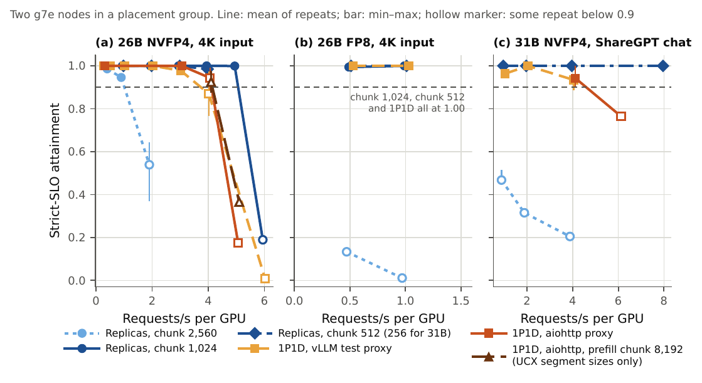
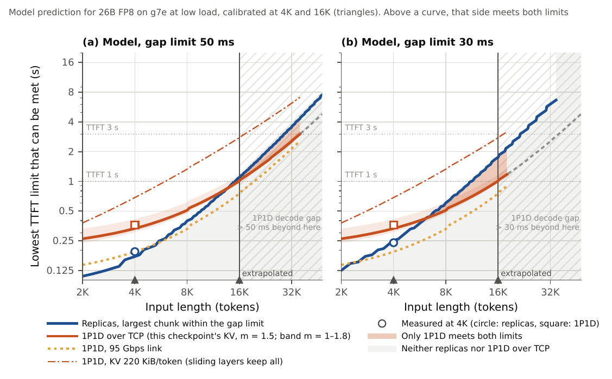

# 청크 먼저: TCP 위의 프리필–디코드 분리는 언제 이득인가

*English: [README.md](README.md)*

측정과 보정 모델: RDMA가 없는 단일 GPU 클라우드 인스턴스(AWS g6e, g7, g7e 2xlarge)에서, 기본 vLLM(v0.30.0, NIXL/UCX over TCP)과 Gemma 4 26B·31B로 청크 프리필 복제본과 프리필–디코드(P/D) 분리를 맞댄 결과입니다.

테크니컬 리포트: [doi:10.5281/zenodo.23085600](https://doi.org/10.5281/zenodo.23085600) · [PDF(영어)](paper/main.pdf) · [한국어판(마크다운)](paper/ko/draft.md) · 코드와 데이터: [doi:10.5281/zenodo.23085749](https://doi.org/10.5281/zenodo.23085749)

블로그 요약: [한국어](https://sunghyunjun.github.io/posts/2026-10-04-pd-disaggregation-over-tcp/) · [English](https://sunghyunjun.github.io/en/posts/2026-10-04-pd-disaggregation-over-tcp/)

## 세 줄 요약

- **청크부터 조정하라.** 복제본은 다른 요청의 프리필이 같은 스케줄러 스텝에 끼면 멈추고, 청크 크기가 그 멈춤의 상한을 정한다. 26B 4K 입력에서 요청별 최대 간격의 중앙값은 청크 2,560토큰에서 48 ms, 512토큰에서 21 ms였다.
- **4K 입력과 대화 트래픽에서는, 청크를 조정한 복제본 앞에서 TCP 분리가 더 많이 처리한 지연 목표가 없었다.** 분리가 이긴 것(26B에서 약 3배)은 청크 2,560에 묶인 복제본뿐인데, 그 값은 vLLM 0.30.0이 비디오 입력을 켠 Gemma 4에 요구하는 하한 근처다.
- **분리의 첫 토큰 추가 시간은 대부분 KV 전송이었다.** UCX의 TCP 세그먼트를 8 KB에서 256 KB로 올리면 저부하에서 전송이 3.4배 빨라지고, 그다음은 클라우드의 흐름당 상한과 NIXL의 4분할이 속도를 정한다.
- **청크로 감당하지 못하는 지점은 입력 길이가 정한다.** 측정으로 보정한 스텝 시간 모델은, 저부하와 50 ms 간격 한도에서 입력 약 14K~37K 토큰(불확실성 안에서 하한 11K~34K) 구간에 청크가 너무 많이 필요해져 TCP 위 1P1D가 1초 이상의 첫 토큰 한도를 복제본보다 먼저 지킨다고 예측한다. KV 캐시가 작아야(하이브리드 어텐션) 성립하며, 측정이 아니라 예측이다.





## TCP로 묶은 작은 GPU 플릿을 위한 절차 (보고서 7.1절)

1. 복제본의 **요청별 최대 간격**을 시스템 백분위가 아니라 요청마다, 실제로 서비스할 부하에서 잰다.
2. **간격 한도에 맞는 가장 큰 청크**를 쓴다. 스택이 그 청크를 허용하는지 확인한다(vLLM 0.30.0의 Gemma 4는 모든 모달리티를 꺼야 2,496 아래로 내려간다).
3. 그 청크의 첫 토큰 시간을 확인한다. 한도를 지키면 거기서 멈춘다.
4. 프리필을 옮기기 전에 줄인다. 접두어 인지 라우팅, 그다음 프롬프트가 반복되면 KV 캐시 로드.
5. 허용되는 어떤 청크로도 두 한도를 함께 지킬 수 없고 전송이 예산에 맞을 때만 TCP 위에서 분리한다(보고서 식 2: KV 용량 ÷ (m × 흐름당 상한) + 잔차).
6. 서빙 경로를 바로잡는다. UCX TCP 세그먼트 크기 올리기, 클러스터 배치 그룹, 연결을 묶지도 가비지 컬렉션으로 멈추지도 않는 프록시.

## 겪은 함정 (부록 B)

- 시스템 전체 토큰 간격 p99는 멀쩡해 보였지만 요청의 48%가 멈췄다. 요청 단위로 판정해야 한다.
- Gemma 4의 멀티모달 예산 검사 때문에 모든 모달리티를 끄기 전에는 청크가 2,496토큰 아래로 내려가지 않았다.
- NIXL용 vLLM 시험 프록시는 2세대 가비지 컬렉션(25~40 ms) 동안 모든 스트림을 멈췄다.
- aiohttp의 기본 연결 상한(100)이 복제본의 지원 부하를 한 단계 낮췄다.

## 저장소 구성

```
analysis/   사후 분석: aggregate.py(런별 지표), safe_runs.py(감사 라벨), slo_sensitivity.py,
            decisive_ci.py(부록 F), boundary_model.py(6절), make_figures.py(+ fig_*.py), chunk31_buckets.py
harness/    측정 시점에 노드에서 돌린 스크립트: serve.sh, serve_pair.sh, run_bench.sh, sweep_ladder.sh,
            프록시(rr_proxy.py, pd_proxy.py, toy_proxy_instr.py), 수집기(node_collect.sh, ss_sample.sh)
configs/    common/ vllm 플래그 묶음과 모델 표; rounds/<회차>/ 회차별 실행 스크립트와 실행표
            (README.md 영어, README.ko.md 한국어 원문; E9 스크립트는 사전 등록 커밋과 바이트 동일)
infra/      Terraform: GPU 노드, 클라이언트 노드, 배치 그룹 (infra/up.sh 전에 ALLOWED_SSH_CIDR 설정)
results/    all_runs.csv(455런), safe_runs.csv(감사 라벨), per_request.json.gz(요청별 시간)
            런별 원자료 폴더는 릴리즈 자산과 Zenodo에 회차별 tar.gz로 (모든 런에서 생성 텍스트 제거, 길이와 시간은 완전)
paper/      main.pdf와 en/ LaTeX 원고, ko/ 한국어판, figures/, reviews/(모의 심사 4차례), tools/(LaTeX→마크다운, 열람 페이지)
RESULTS.md  실험 노트(한국어, 영어 안내는 RESULTS.en.md). 마지막 회차 전에 커밋한 예측 포함
PROTOCOL.md 사전 등록 프로토콜 v1.7(첫 측정 전 커밋, 한국어 원문). 영어 번역은 PROTOCOL.en.md
```

## 보고서 수치와 그림 재현

`aggregate.py`, `safe_runs.py`, `chunk31_buckets.py`, `make_figures.py`(E8의 전송 로그와 소켓 표본)는 런별 원자료를 읽으므로, 먼저 릴리즈 자산(`results-<회차>.tar.gz`, 체크섬 `SHA256SUMS.txt`)을 `results/<회차>/`에 풉니다. `boundary_model.py`와 `decisive_ci.py`는 커밋된 `safe_runs.csv`와 `per_request.json.gz`만으로 돕니다.

```
python3 analysis/aggregate.py results/ -o results/all_runs.csv                 # 모든 런, 기본값이 보고서의 SLO
python3 analysis/safe_runs.py results/all_runs.csv -o results/safe_runs.csv   # 감사: 안전 / 주의 / 제외
uv run --with numpy python3 analysis/boundary_model.py --json paper/figures/boundary.json   # 6절 모델, 표 3
uv run --with matplotlib python3 analysis/make_figures.py                   # 그림 → paper/figures (boundary_model.py 뒤에)
python3 analysis/decisive_ci.py --tex                                           # 부록 F
python3 analysis/chunk31_buckets.py                                             # 4.2절, 31B 프롬프트 길이 구간
cd paper/en && tectonic main.tex && cp main.pdf ../main.pdf                     # PDF
```

`results/per_request.json.gz`는 `safe_runs.csv`와 어긋나면 자동으로 다시 만들어집니다(`--rebuild`로 강제). 분석 스크립트는 커밋된 CSV와 `figures.json`을 바이트 단위로 똑같이 다시 만듭니다.

## 어떻게 했나

한 사람이 클라우드 비용 약 270달러로 아홉 회차 455런을 돌렸습니다. 프로토콜은 첫 런 전에, 마지막 회차의 예측은 그 회차 전에 커밋했습니다(부록 D, E). AI의 도움을 받은 모의 동료 심사 네 차례가 `paper/reviews/`에 있고, 앞의 두 차례가 추가 측정 두 회차를 이끌었으며 네 번째는 6절의 모델을 검토했습니다. AI 코딩 도우미(Claude)가 하네스와 분석 스크립트를 쓰고, 인프라를 운영하고, 모의 심사를 돌리고, 본문과 그림 초안을 만들었습니다. 저자는 연구를 설계하고, 측정 비용을 내고 방향을 정하고, 보고한 수치를 원자료와 대조했습니다.

이 공개 저장소의 유래: 비공개 작업 저장소의 이력에서 AWS 계정 ID, 로컬 경로, 개인 작업 공간 이름을 치환하거나 지우고, 런별 원자료 폴더와 내부 메모 폴더, 낡은 초안, 내부 할 일 파일을 빼고, 커밋 메시지의 도구 세션 꼬리말을 지우고, 저자 이메일을 하나로 맞췄습니다(`git filter-repo`). 번들 기준 이후의 커밋은 독자를 위해 트리를 재배치하고 코드 주석을 영어로 옮긴 것이며, 데이터와 스크립트 논리는 바뀌지 않았습니다. `commit-map.txt`가 옛 해시와 새 해시를 대응시킵니다. 원본 저장소의 번들은 저자가 보관하며, SHA-256은 보고서 부록 G에 있습니다.

## 라이선스

코드: Apache-2.0. 본문, 그림, 데이터: CC BY 4.0. `LICENSE` 참고.
